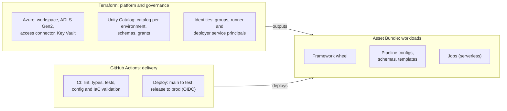

# Databricks YAML ETL Framework

[](https://github.com/pgdataconsulting/databricks_etl/actions/workflows/ci.yml)
[](LICENSE)


A declarative ETL framework for Databricks. Pipelines are YAML files; the
framework validates them, turns them into PySpark, and runs them with schema
contracts, data quality gates, lineage and an audit trail built in. The
repository also contains everything needed to operate it: infrastructure as
code for Azure Databricks and Unity Catalog, an access model, a deployable
job, and CI/CD without stored secrets.

```yaml
process_name: orders_silver
parameters:
  catalog: etl_dev
settings:
  watermark:                         # only what changed since the last good run
    enabled: true
    source: new_orders
    column: updated_at
    initial: "1900-01-01 00:00:00"
    table: ${catalog}.etl_state.watermarks
steps:
  - name: read_bronze_orders
    type: read
    format: table
    table: ${catalog}.bronze.orders_raw
    alias: orders_raw
  - name: only_changed_orders
    type: filter
    input: orders_raw
    condition: "updated_at > '${watermark}'"
    output: new_orders
  - name: latest_version_per_order
    type: deduplicate
    input: new_orders
    partition_by: [order_id]
    order_by: ["updated_at desc"]
    output: latest_orders
  - name: check_orders
    type: quality
    input: latest_orders
    on_failure: quarantine           # bad rows are set aside, not loaded or lost
    quarantine_table: ${catalog}.quarantine.orders
    checks:
      - {type: not_null, columns: [order_id, customer_id]}
      - {type: expression, condition: "order_amount >= 0"}
    output: clean_orders
  - name: upsert_silver_orders
    type: merge                      # idempotent: a rerun cannot double-load
    input: clean_orders
    merge_keys: [order_id]
    table: ${catalog}.silver.orders
    schema_ref: medallion/silver_orders
```

## Try it

You need Python 3.10+ and Java 17+. Nothing else: the example brings its own
data and runs on a local Spark session.

```bash
git clone https://github.com/pgdataconsulting/databricks_etl.git
cd databricks_etl
python -m venv .venv && source .venv/bin/activate
pip install -e ".[spark]"
make demo
```

Three pipelines run in order (sample data, bronze to silver, silver to gold)
and the result is printed:

```text
== medallion_orders_silver: succeeded in 5.339s
   read_bronze_orders               succeeded  rows=8
   only_changed_orders              succeeded  rows=8
   latest_version_per_order         succeeded  rows=7
   check_orders                     succeeded  rows=5
   upsert_silver_orders             succeeded  rows=5

== gold.customer_daily_revenue (published)
+----------+-----------+-------------+-------+-----------+-------+
|order_date|customer_id|customer_name|country|order_count|revenue|
+----------+-----------+-------------+-------+-----------+-------+
|2026-07-07|          1|  Alice Novak|     PL|          2|  430.5|
|2026-07-07|          2|  Bruno Costa|     PT|          1|   75.0|
|2026-07-07|          9|      UNKNOWN|     ??|          1|   64.0|
+----------+-----------+-------------+-------+-----------+-------+

== quarantine.orders (rows that broke a rule, kept for inspection)
+--------+-----------+------------+------+
|order_id|customer_id|order_amount|status|
+--------+-----------+------------+------+
|    1004|          3|       -15.0|   NEW|
|    1005|       NULL|        42.0|   NEW|
+--------+-----------+------------+------+
```

Validating and documenting configurations needs no Spark at all:

```bash
pip install -e .
etl-framework validate configs/*.yaml configs/medallion/*.yaml
etl-framework docs configs/medallion/orders_silver.yaml
etl-framework run configs/medallion/orders_silver.yaml --dry-run
```

## What it does

- **24 operation types.** `read`, `write`, `select`, `filter`, `join`, `union`,
  `aggregate`, `pivot`, `unpivot`, `window`, `expression`, `add_columns`,
  `deduplicate`, `sample`, `cache`, `quality`, `merge`, `scd2`, `cdc`,
  `reconcile`, `lookup`, `fuzzy_match`, `run_config` (a pipeline as a step of
  another), and opt-in free-form `sql`. Your own operations plug in from a
  separate package.
- **Fail-fast validation.** Missing fields, unknown operations, dangling
  references, missing parameters and broken schema references are all
  reported together, before anything executes. An invalid configuration
  cannot cause a write.
- **Schema contracts.** Datasets are described in versioned files under
  `schemas/` and enforced on read and before every write, with explicit drift
  policies (`fail`, `evolve`, `overwrite`).
- **Data quality gates.** `not_null`, `unique`, `accepted_values`,
  `expression` and `row_count` checks that fail the run, warn, or quarantine
  the offending rows.
- **Incremental patterns.** Delta `MERGE` upserts, SCD Type 2, CDC apply,
  dynamic partition overwrite, and persisted watermarks that never advance
  on a failed run.
- **Secrets by reference.** `${secret:scope/key}` is resolved when the step
  runs and never appears in plans, lineage, summaries, audit tables or logs;
  values echoed by Spark errors are masked.
- **One file per pipeline, every environment.** Parameters and per-environment
  overrides; the steps are identical in dev, test and prod.
- **Observability.** One JSON log line per event, per-step durations and row
  counts, Delta audit tables, dataset lineage in every run summary, optional
  OpenLineage events.
- **Tooling.** A CLI to validate, document and run pipelines, dry-run mode,
  generated pipeline docs with lineage diagrams, retries with backoff,
  conditional steps, reusable templates.

Every feature is described with examples in the [user guide](docs/usage.md).

## How it is deployed

Three layers, each with one job:



- **[`infra/terraform`](infra/terraform)** provisions the Azure resources, a
  Unity Catalog catalog per environment, and who may do what.
- **[`databricks.yml`](databricks.yml)** deploys the wheel, the configurations
  and the jobs. Adding a pipeline to the platform is adding a YAML file and a
  task; there is no pipeline-specific code.
- **[`.github/workflows`](.github/workflows)** checks every change and promotes
  it: `main` to `test`, a published release to `prod`.

The step-by-step is in the [deployment guide](docs/deployment.md).

### Who can do what

| Identity | What it is for | Data access |
| --- | --- | --- |
| Platform admins (group) | Own the catalog and the jobs | Everything |
| Data engineers (group) | Develop pipelines | Read and write in non-production; read-only in production |
| Data analysts (group) | Consume published data | Read `gold` only |
| Runner (service principal) | The identity jobs run as | Read and write the pipeline schemas |
| Deployer (service principal) | CI/CD, authenticated by GitHub OIDC | None; it deploys jobs and cannot read data |

No human needs write access to production data, and no pipeline credential is
stored in GitHub. The reasoning, the grant matrix and the trust boundaries are
in [docs/security.md](docs/security.md).

## Repository layout

```text
etl_framework/        the Python package: runner, validator, operations, secrets, CLI
configs/              example pipelines; configs/medallion is the deployable one
schemas/              schema contracts enforced on read and write
templates/            reusable step templates
examples/             the local quickstart
notebooks/            generic notebook entry point for Azure Data Factory
resources/            job definitions of the Asset Bundle
databricks.yml        the Asset Bundle
infra/terraform/      Azure platform, Unity Catalog, identities and grants
docs/                 guides, and generated per-pipeline docs under docs/pipelines
tests/                pytest suite on real local Spark and Delta, nothing mocked
```

## Documentation

- [User guide](docs/usage.md): every operation, setting and feature.
- [Architecture](docs/architecture.md): how a file becomes a run, and the
  design decisions behind it.
- [Deployment guide](docs/deployment.md): from an empty subscription to a
  scheduled job.
- [Security](docs/security.md): identities, grants, secrets, trust model.
- [Operations runbook](docs/operations.md): monitoring, failures, reruns.
- [Generated pipeline docs](docs/pipelines): one page per example pipeline.
- [Design specification](docs/specification.md): the original requirements.

## Status

Version 1.0.0. What has and has not been exercised:

- The framework is covered by more than 200 tests that run real Spark and
  Delta Lake, on Python 3.10 to 3.12 against Spark 3.5, 4.0 and the latest
  release.
- The medallion example is part of that suite and is what the job deploys.
- The Terraform stacks pass `terraform validate` and tests with mocked
  providers that assert the access model; the bundle is checked against the
  Databricks CLI's schema. Neither has been applied to a live Azure
  subscription and workspace from this repository yet, so expect the first
  apply and deployment to need adjustments for your tenant.

## Contributing

See [CONTRIBUTING.md](CONTRIBUTING.md). Security reports go through
[SECURITY.md](SECURITY.md), not public issues.

## License

[MIT](LICENSE)
