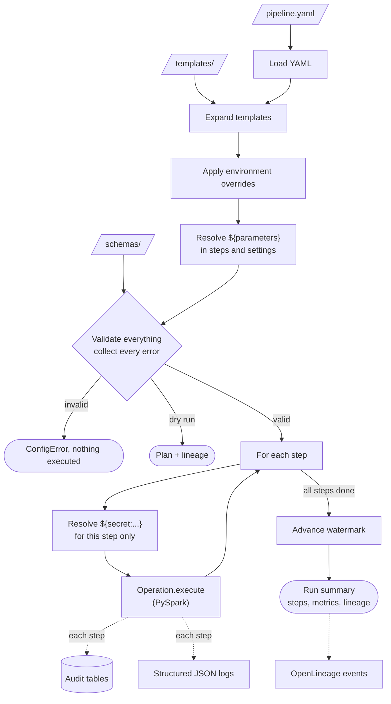

# Architecture

How the framework is put together, and why. For how to use it see the
[user guide](usage.md); for how it is deployed see the
[deployment guide](deployment.md).

## The idea

A pipeline is data, not code. A YAML file says *what* happens to which
datasets; the framework decides *how* that becomes PySpark. The engine is
written and tested once, and everything that differs between two pipelines is
in a file that can be reviewed, validated without a cluster, diffed, and
documented automatically.

## From a file to a run

The stages before execution are pure functions of the files and the
parameters. That is what makes `validate`, `docs` and `--dry-run` possible
without Spark, and it is why an invalid configuration can never cause a
write: every problem (missing fields, unknown operations, dangling DataFrame
references, missing parameters, broken schema references, malformed secret
references) is found and reported together before the first step runs.

## Building blocks

| Module | Responsibility |
| --- | --- |
| `config_loader` | Read YAML from a local, Workspace, Volume or DBFS path, or inline text |
| `template_loader` | Expand `use_template` entries into parameterized step sequences |
| `environment_overrides` | Merge the active environment's parameter and settings overrides |
| `parameter_resolver` | Merge defaults with runtime values; substitute `${name}` |
| `config_validator` | Structural validation; collects every error |
| `schema_registry` | Schema contracts from `schemas/`, enforced on read and before write |
| `operations/` | One class per step type, in a registry open to plugins |
| `execution_context` | The state of a run: Spark session, DataFrames by name, settings, secrets |
| `runner` | Orchestrates the stages above; retries, conditional steps, metrics |
| `secrets` | Late resolution of secret references, pluggable providers, masking |
| `watermark` | Persisted high-water mark per pipeline for incremental loads |
| `lineage` | Dataset lineage from the config; optional OpenLineage emission |
| `logging/` | One JSON log line per event; optional Delta audit tables |
| `cli` | `validate`, `docs`, `run` |

### Operations

Every step type is a subclass of `Operation` with three duties: say which
fields it requires and validate the rest (`validate`), say which DataFrames
it consumes and produces (`input_names`, `output_names`), and do the work
(`execute`). The validator and the lineage, plan and documentation generators
only use the first two, so a new operation gets validation, dry-run, lineage
and docs without writing any of them.

Operations reach Spark only inside `execute`, and import PySpark there rather
than at module level. The package therefore imports without Spark installed.

### Extension points

Both follow the same principle: the framework depends on an interface, and
the implementation is supplied from outside.

- **Operations** are looked up in a registry. Besides the built-in ones, any
  installed package can contribute operation classes through the
  `etl_framework.operations` entry-point group, so organization-specific
  steps live in the organization's own package and release cycle.
- **Secret providers** are any object with `get(scope, key)`. The default is
  chosen by environment (Databricks secret scopes on Databricks compute,
  environment variables elsewhere); a different vault is one argument to
  `run_pipeline`.

## Design decisions

**Fail before, not during.** All validation happens before execution and
reports every problem at once. A pipeline that fails halfway leaves partial
state; a pipeline that is rejected leaves none.

**Secrets are resolved late and never reported.** A reference is replaced by
its value in a copy of the step, at the moment the step runs. Everything the
framework reports (logs, plan, lineage, audit, summary) is derived from the
original step, so it carries the reference. Because Spark error messages
routinely quote connection options, resolved values are also masked in logs
and in raised errors. A failure of a step that used a secret leaves the
framework as a masked message only, without the chained Spark exception and
without the failing step's traceback, since both can hold the value.

**Audit never fails a run; watermarks always do.** Losing an audit row is an
observability gap. Losing or mis-advancing a watermark is a correctness bug:
rows get skipped or loaded twice. So audit and lineage failures are logged
and swallowed, while a watermark that cannot be read or written fails the
run. A failed run never advances the watermark, which is why watermarking is
meant to be paired with idempotent sinks (`merge`, `scd2`,
`mode: overwrite_partitions`).

**Environments differ in parameters, not in logic.** The `environments:`
block can override parameters and settings only. Steps are the same
everywhere, so what was tested in `test` is what runs in `prod`.

**Free-form SQL is opt-in.** The `sql` step exists because some logic is
clearer as a query, but it bypasses the declarative model (its inputs are not
visible to the validator or to lineage), so a pipeline has to enable it with
`settings.allow_sql: true`.

**No hard dependency on PySpark.** The runtime provides Spark on Databricks,
and pinning it in the package would fight the runtime. PyYAML is the only
install requirement; the `spark` extra exists for local runs.

**Platform and workloads are deployed separately.** Terraform owns what
changes rarely and needs elevated rights (workspace, Unity Catalog,
identities, grants). The Asset Bundle owns what changes with every pull
request (the wheel, the configs, the jobs). They are connected by a handful
of Terraform outputs.

## Compatibility

CI runs the test suite on these combinations:

| Python | PySpark | Delta Lake |
| --- | --- | --- |
| 3.10 | 3.5 | 3.3 |
| 3.11 | 3.5 | 3.3 |
| 3.12 | 4.0 | 4.0 |
| 3.12 | latest | latest |

### Compute

The framework uses DataFrame and SQL APIs only, with one exception, so
pipelines run on serverless compute and on classic clusters:

- The `cache` step persists or checkpoints a DataFrame, which serverless
  compute does not support. Pipelines that use it need a classic job cluster.
- `merge` with `schema_evolution: true` sets a Delta session configuration
  for the duration of the statement. This has been exercised on local Delta
  only; check it in your workspace before relying on it on serverless.

Reading configuration files works from any path that is visible as a file to
the driver: Workspace files, Unity Catalog Volumes, and `dbfs:/` (classic
compute only).
