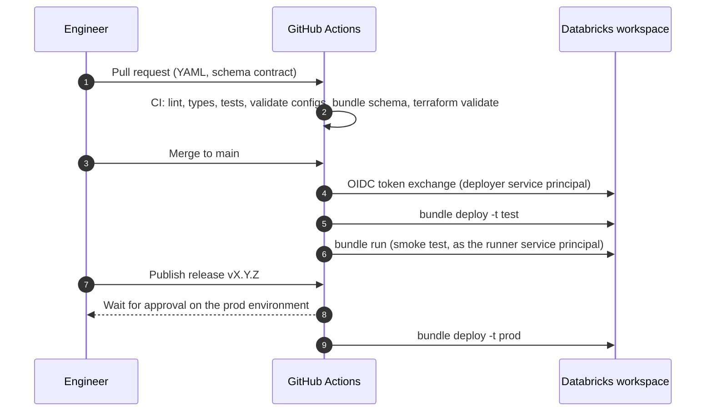

# Deployment guide

From an empty Azure subscription to a scheduled, monitored job. There are
three layers, deployed in this order and owned by different people:

| Layer | Tool | Changes | Typically owned by |
| --- | --- | --- | --- |
| Platform: workspace, storage, Key Vault | Terraform (`stacks/platform`) | Rarely | Platform team |
| Governance: Unity Catalog, identities, grants | Terraform (`stacks/governance`) | When access changes | Platform team, data owners |
| Workloads: wheel, configs, jobs | Asset Bundle (`databricks.yml`) | Every pull request | Data engineers, through CI |



## Prerequisites

- An Azure subscription and a Databricks account with Unity Catalog. The
  roles needed to apply each Terraform stack are listed in
  [`infra/terraform/README.md`](../infra/terraform/README.md).
- Terraform 1.9 or newer, and the Databricks CLI (this repository is checked
  against the schema of CLI 1.23.0).
- [uv](https://docs.astral.sh/uv/) on the machine that deploys the bundle;
  the bundle builds the wheel with `uv build`.

## 1. Platform and governance (Terraform)

Each environment (`dev`, `test`, `prod`) is one apply of each stack with its
own variables and its own state. The exact commands, variables and the
bootstrap order are in [`infra/terraform/README.md`](../infra/terraform/README.md);
in outline:

1. **`stacks/platform`** creates the resource group, the ADLS Gen2 storage
   account, the access connector, the Databricks workspace and the Key Vault.
   Its `governance_inputs` output is written to a file that the next stack
   reads, so nothing is copied by hand.
2. **`stacks/governance`** creates the catalog and schemas, looks up or
   creates the groups, creates the runner and deployer service principals,
   applies the grants, and creates the secret scope and the federation
   policy that lets GitHub Actions sign in as the deployer.

When the governance stack has been applied, read the values the next steps
need:

```bash
terraform -chdir=infra/terraform/stacks/governance output
```

| Terraform output | Used as |
| --- | --- |
| `workspace_url` | `DATABRICKS_HOST` |
| `deployer_application_id` | `DATABRICKS_CLIENT_ID` in GitHub Actions |
| `runner_application_id` | Bundle variable `runner_service_principal` |
| `catalog_name` | Bundle variable `catalog` |
| `group_names` | Bundle variables `admins_group`, `engineers_group` |
| `secret_scope_name` | The `<scope>` in `${secret:<scope>/<key>}` |
| `github_oidc_subject` | What the deploy job's OIDC token must present |

## 2. A first deployment from your machine

The `dev` target deploys a personal copy: resources are prefixed with your
user name, schedules are paused, and the job runs as you. It is the way to
try a change on real compute before opening a pull request. You need to be a
member of the data engineers group, which can write to the `dev` catalog.

```bash
databricks auth login --host <workspace_url> --profile etl-dev

databricks bundle validate --strict -t dev --profile etl-dev
databricks bundle deploy -t dev --profile etl-dev
databricks bundle run medallion_orders -t dev --profile etl-dev
```

`bundle run` waits for the job and prints each task's result. The run summary
of each pipeline is in the task output; the tables are in `etl_dev`.

Remove your copy with `databricks bundle destroy -t dev --profile etl-dev`.

## 3. Continuous delivery (GitHub Actions)

[`deploy.yml`](../.github/workflows/deploy.yml) deploys `main` to `test` and a
published release to `prod`. It signs in as the deployer service principal
with GitHub OIDC; there is no secret to create.

1. In the repository settings, create the environments `test` and `prod`. On
   `prod`, add required reviewers: that approval is the production gate. The
   names matter: the deployer's federation policy trusts the environment
   named in the governance stack's `github_environment` and no other.
2. On each environment set these **variables** (not secrets):

   | Variable | Value |
   | --- | --- |
   | `DATABRICKS_HOST` | Terraform output `workspace_url` |
   | `DATABRICKS_CLIENT_ID` | Terraform output `deployer_application_id` |
   | `RUNNER_APPLICATION_ID` | Terraform output `runner_application_id` |

3. Set the repository variable `DEPLOY_ENABLED` to `true`. Until then the
   deploy workflow is skipped, so a fork or a repository without a workspace
   does not fail on every push.
4. If the catalog or group names differ from the defaults in
   `databricks.yml`, change them in the target's `variables`.

The federation policy trusts one exact subject, a repository plus an
environment. If a deployment fails to authenticate, compare the Terraform
output `github_oidc_subject` with the `sub` claim of the workflow's token;
repositories created, renamed or transferred after 15 July 2026 use a subject
format with numeric ids, which the Terraform README explains how to set.

### Releasing to production

```bash
# bump __version__ in etl_framework/__init__.py and add a CHANGELOG section
git tag v1.1.0 && git push origin v1.1.0
```

The tag builds the wheel and publishes a GitHub release with the changelog
section ([`release.yml`](../.github/workflows/release.yml)). Publishing the
release starts the production deployment, which waits for the reviewers of
the `prod` environment.

## 4. Adding a pipeline

Nothing in the framework changes; a pipeline is three small additions in one
pull request:

1. The configuration, `configs/<area>/<name>.yaml`, and the schema contracts
   it references under `schemas/`.
2. A task in a job under `resources/` (or a new job file), following
   [`resources/medallion_orders.job.yml`](../resources/medallion_orders.job.yml):

   ```yaml
   - task_key: <name>
     environment_key: default
     python_wheel_task:
       package_name: databricks_yaml_etl
       entry_point: etl_framework
       parameters:
         - run
         - ${workspace.file_path}/configs/<area>/<name>.yaml
         - --param
         - catalog={{job.parameters.catalog}}
         - --param
         - environment=${bundle.target}
         - --run-id
         - "{{job.run_id}}-<name>"
   ```

3. The generated documentation: `make pipeline-docs`.

CI validates the configuration and the bundle; merging deploys it to `test`.
Source-system credentials go into the secret scope and are referenced as
`${secret:<scope>/<key>}`.

## Orchestrating from Azure Data Factory

Where Azure Data Factory is the scheduler, it triggers the generic notebook
[`notebooks/run_pipeline.py`](../notebooks/run_pipeline.py) with the widgets
`config_path`, `business_date`, `environment`, `run_id` and
`extra_parameters` (JSON). The notebook returns the run summary through
`dbutils.notebook.exit`, so the ADF activity output contains the status, the
steps and their row counts. The notebook and the configurations are uploaded
by the bundle; point `config_path` at
`<bundle root>/files/configs/<area>/<name>.yaml`. The wheel has to be
available to the notebook's compute, for example as a library of the cluster
or of the notebook environment.

## Compute

The job runs on serverless compute with `performance_target: STANDARD`: a
daily batch has no deadline, so it trades a start-up delay of a few minutes
for lower cost. Set `PERFORMANCE_OPTIMIZED` on a job that people wait for or
that runs every few minutes.

A pipeline that uses the `cache` step needs a classic job cluster, because
serverless compute does not support persisting DataFrames. Give that task a
cluster and attach the wheel as a library instead of through the
environment:

```yaml
      job_clusters:
        - job_cluster_key: classic
          new_cluster:
            spark_version: <current LTS runtime, e.g. 16.4.x-scala2.12>
            node_type_id: <a node type in your region>
            data_security_mode: SINGLE_USER
            autoscale: {min_workers: 1, max_workers: 4}
      tasks:
        - task_key: <name>
          job_cluster_key: classic
          libraries:
            - whl: ../dist/*.whl
          python_wheel_task: ...
```

## What has been verified

Being exact about this matters more than sounding finished:

- The framework and the medallion example: tested on real Spark and Delta
  Lake, locally and in CI, on the version matrix in
  [architecture.md](architecture.md#compatibility).
- The bundle: valid against the JSON schema of Databricks CLI 1.23.0.
  `databricks bundle validate` and `deploy` need a workspace and have not
  been run from this repository.
- The Terraform stacks: `terraform validate` passes, and `terraform test`
  with mocked providers asserts the names, the input validation and the
  access model. They have not been planned or applied against a live
  subscription.
- The workflows: checked with actionlint. The deploy and release workflows
  have not run yet.

Expect the first apply and the first deployment to need small adjustments
for your tenant: names, regions, quotas, and network rules.
