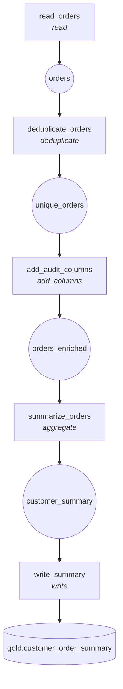

# Pipeline: customer_order_summary

Spec version: `1.0`

Source configuration: `configs/customer_order_summary.yaml`

## Parameters

| Name | Default |
| --- | --- |
| `business_date` | `(required at runtime)` |

## Steps

| # | Step | Type | Inputs | Output | Details |
| --- | --- | --- | --- | --- | --- |
| 1 | `read_orders` | read |  | orders | `format: parquet` `path: abfss://datalake/silver/orders` |
| 2 | `deduplicate_orders` | deduplicate | orders | unique_orders |  |
| 3 | `add_audit_columns` | add_columns | unique_orders | orders_enriched |  |
| 4 | `summarize_orders` | aggregate | orders_enriched | customer_summary |  |
| 5 | `write_summary` | write | customer_summary |  | `format: table` `mode: overwrite` `table: gold.customer_order_summary` |

## Lineage

