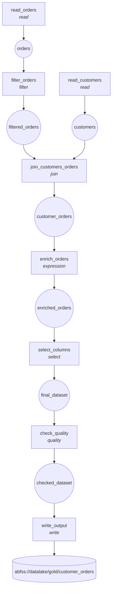

# Pipeline: customer_orders_etl

Spec version: `1.0`

Source configuration: `configs/customer_orders.yaml`

## Parameters

| Name | Default |
| --- | --- |
| `business_date` | `(required at runtime)` |
| `environment` | `dev` |

## Settings

- `log_row_counts`: `true`

## Steps

| # | Step | Type | Inputs | Output | Details |
| --- | --- | --- | --- | --- | --- |
| 1 | `read_customers` | read |  | customers | `format: delta` `path: abfss://datalake/silver/customers` `schema_ref: silver/customers` |
| 2 | `read_orders` | read |  | orders | `format: delta` `path: abfss://datalake/silver/orders` `schema_ref: silver/orders` |
| 3 | `filter_orders` | filter | orders | filtered_orders | `condition: order_date = '${business_date}'` |
| 4 | `join_customers_orders` | join | filtered_orders, customers | customer_orders | `condition: ['filtered_orders.customer_id = customers.customer_id']` `join_type: left` |
| 5 | `enrich_orders` | expression | customer_orders | enriched_orders |  |
| 6 | `select_columns` | select | enriched_orders | final_dataset |  |
| 7 | `check_quality` | quality | final_dataset | checked_dataset | `on_failure: fail` |
| 8 | `write_output` | write | checked_dataset |  | `format: delta` `mode: overwrite` `path: abfss://datalake/gold/customer_orders` `schema_ref: gold/customer_orders` |

## Lineage

