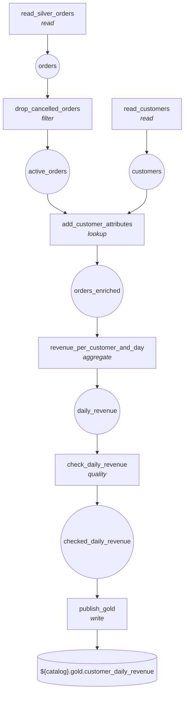

# Pipeline: medallion_customer_revenue_gold

Spec version: `1.0`

Source configuration: `configs/medallion/customer_revenue_gold.yaml`

## Parameters

| Name | Default |
| --- | --- |
| `catalog` | `spark_catalog` |
| `environment` | `dev` |

## Settings

- `log_row_counts`: `true`
- `audit`: `{"enabled": true, "schema": "${catalog}.etl_audit"}`

## Steps

| # | Step | Type | Inputs | Output | Details |
| --- | --- | --- | --- | --- | --- |
| 1 | `read_silver_orders` | read |  | orders | `format: table` `table: ${catalog}.silver.orders` `schema_ref: medallion/silver_orders` |
| 2 | `read_customers` | read |  | customers | `format: table` `table: ${catalog}.bronze.customers_raw` |
| 3 | `drop_cancelled_orders` | filter | orders | active_orders | `condition: status <> 'CANCELLED'` |
| 4 | `add_customer_attributes` | lookup | active_orders, customers | orders_enriched |  |
| 5 | `revenue_per_customer_and_day` | aggregate | orders_enriched | daily_revenue |  |
| 6 | `check_daily_revenue` | quality | daily_revenue | checked_daily_revenue | `on_failure: fail` |
| 7 | `publish_gold` | write | checked_daily_revenue |  | `format: table` `mode: overwrite` `table: ${catalog}.gold.customer_daily_revenue` `schema_ref: medallion/gold_customer_daily_revenue` |

## Lineage

