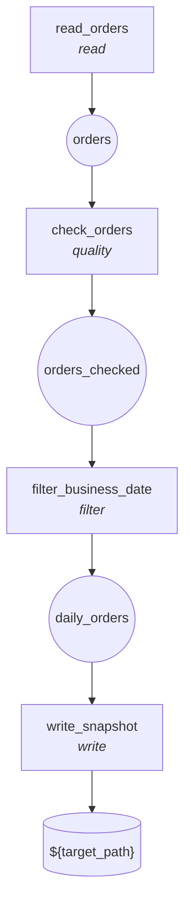

# Pipeline: orders_daily_snapshot

Spec version: `1.0`

Source configuration: `configs/orders_daily_snapshot.yaml`

## Parameters

| Name | Default |
| --- | --- |
| `business_date` | `(required at runtime)` |
| `environment` | `dev` |
| `target_path` | `abfss://dev-datalake/gold/orders_snapshot` |

## Settings

- `log_row_counts`: `true`
- `lineage`: `{"enabled": true, "transport": "console", "namespace": "datalake"}`

## Steps

| # | Step | Type | Inputs | Output | Details |
| --- | --- | --- | --- | --- | --- |
| 1 | `read_orders` | read |  | orders | `format: delta` `path: abfss://datalake/silver/orders` |
| 2 | `check_orders` | quality | orders | orders_checked | `on_failure: fail` |
| 3 | `filter_business_date` | filter | orders_checked | daily_orders | `condition: order_date = '${business_date}'` |
| 4 | `write_snapshot` | write | daily_orders |  | `format: delta` `mode: overwrite` `path: ${target_path}` |

## Lineage

