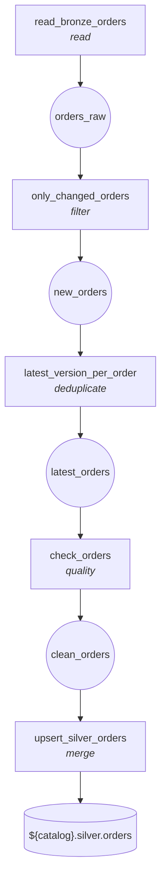

# Pipeline: medallion_orders_silver

Spec version: `1.0`

Source configuration: `configs/medallion/orders_silver.yaml`

## Parameters

| Name | Default |
| --- | --- |
| `catalog` | `spark_catalog` |
| `environment` | `dev` |

## Settings

- `log_row_counts`: `true`
- `audit_columns`: `["_run_id", "_load_timestamp"]`
- `audit`: `{"enabled": true, "schema": "${catalog}.etl_audit"}`
- `watermark`: `{"enabled": true, "source": "new_orders", "column": "updated_at", "initial": "1900-01-01 00:00:00", "table": "${catalog}.etl_state.watermarks"}`

## Steps

| # | Step | Type | Inputs | Output | Details |
| --- | --- | --- | --- | --- | --- |
| 1 | `read_bronze_orders` | read |  | orders_raw | `format: table` `table: ${catalog}.bronze.orders_raw` |
| 2 | `only_changed_orders` | filter | orders_raw | new_orders | `condition: updated_at > '${watermark}'` |
| 3 | `latest_version_per_order` | deduplicate | new_orders | latest_orders |  |
| 4 | `check_orders` | quality | latest_orders | clean_orders | `on_failure: quarantine` `quarantine_table: ${catalog}.quarantine.orders` |
| 5 | `upsert_silver_orders` | merge | clean_orders |  | `table: ${catalog}.silver.orders` `schema_ref: medallion/silver_orders` |

## Lineage

