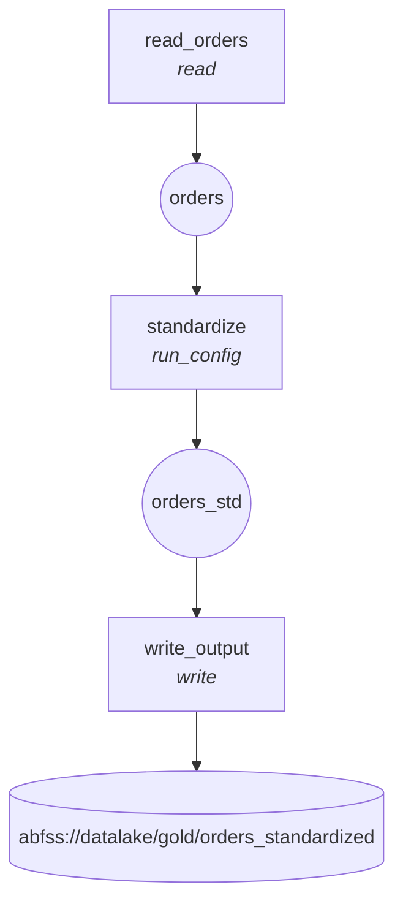

# Pipeline: orders_with_standardization

Spec version: `1.0`

Source configuration: `configs/orders_with_standardization.yaml`

## Parameters

| Name | Default |
| --- | --- |
| `business_date` | `(required at runtime)` |
| `environment` | `dev` |

## Settings

- `log_row_counts`: `true`

## Steps

| # | Step | Type | Inputs | Output | Details |
| --- | --- | --- | --- | --- | --- |
| 1 | `read_orders` | read |  | orders | `format: delta` `path: abfss://datalake/silver/orders` `schema_ref: silver/orders` |
| 2 | `standardize` | run_config | orders | orders_std | `config_path: standardize_orders.yaml` |
| 3 | `write_output` | write | orders_std |  | `format: delta` `mode: overwrite` `path: abfss://datalake/gold/orders_standardized` |

## Lineage

