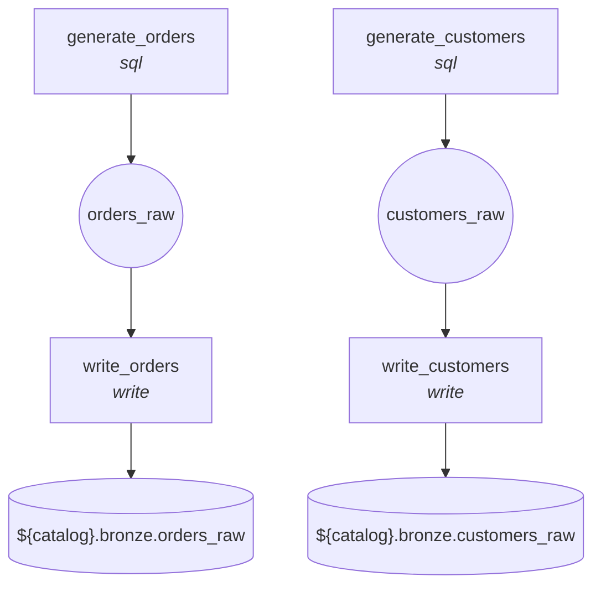

# Pipeline: medallion_seed_sample_data

Spec version: `1.0`

Source configuration: `configs/medallion/seed_sample_data.yaml`

## Parameters

| Name | Default |
| --- | --- |
| `catalog` | `spark_catalog` |
| `business_date` | `(required at runtime)` |

## Settings

- `allow_sql`: `true`
- `log_row_counts`: `true`

## Steps

| # | Step | Type | Inputs | Output | Details |
| --- | --- | --- | --- | --- | --- |
| 1 | `generate_orders` | sql |  | orders_raw |  |
| 2 | `write_orders` | write | orders_raw |  | `format: table` `mode: overwrite` `table: ${catalog}.bronze.orders_raw` |
| 3 | `generate_customers` | sql |  | customers_raw |  |
| 4 | `write_customers` | write | customers_raw |  | `format: table` `mode: overwrite` `table: ${catalog}.bronze.customers_raw` |

## Lineage

