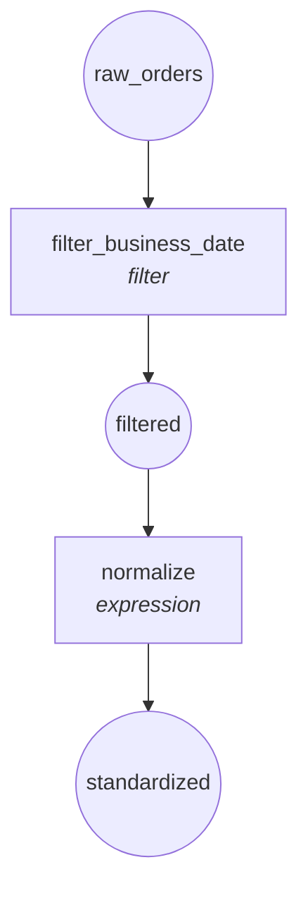

# Pipeline: standardize_orders

Spec version: `1.0`

Source configuration: `configs/standardize_orders.yaml`

## Parameters

| Name | Default |
| --- | --- |
| `business_date` | `(required at runtime)` |

## Steps

| # | Step | Type | Inputs | Output | Details |
| --- | --- | --- | --- | --- | --- |
| 1 | `filter_business_date` | filter | raw_orders | filtered | `condition: order_date = '${business_date}'` |
| 2 | `normalize` | expression | filtered | standardized |  |

## Lineage

